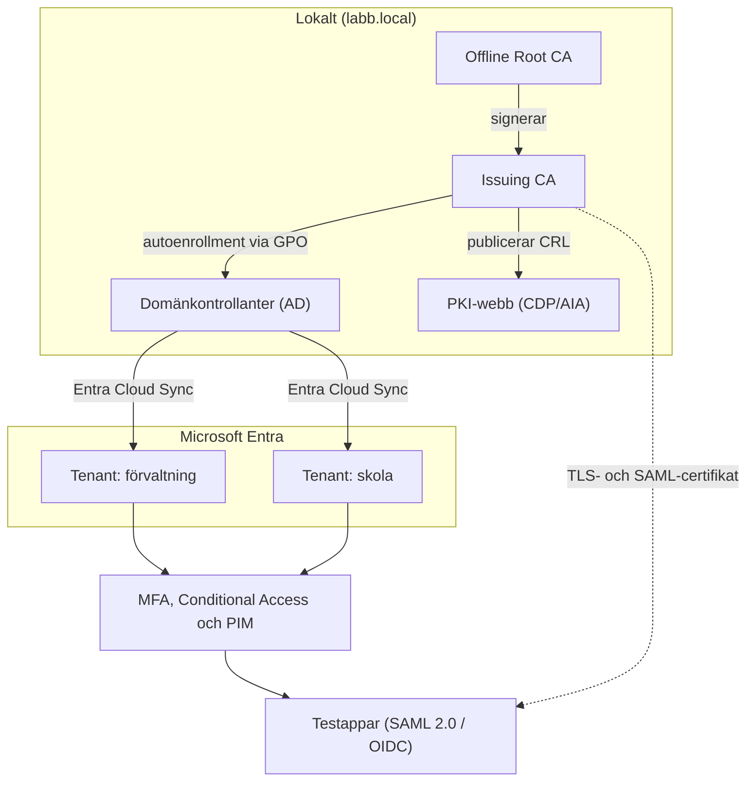

# Kommunal IAM-plattform

Ett labbbaserat portfolioprojekt som visar hur en kommunal identitetsmiljö kan byggas, säkras och kravställas. Projektet utgår från rollen som IAM-specialist: Active Directory, Microsoft Entra ID, MFA, federation, PKI och teknisk kravställning vid anskaffning.

> **Avgränsning:** Allt här är en labb. Domän `labb.local`, tenant `labb.onmicrosoft.com`, leverantörer och värden är fiktiva. Ingen riktig kunddata ingår. Kontrollera licenskrav och Microsofts aktuella dokumentation innan skripten körs, eftersom funktioner och namn ändras.

## Arkitektur



## Faser och status

| Fas | Område | Innehåll | Status |
|---|---|---|---|
| 1 | Grund (hybrid, två tenants) | DC, Entra Cloud Sync, UPN-strategi | Planerad |
| 2 | Identitetsförsörjning | HR-CSV, joiner/mover/leaver, migrering från MIM | Planerad |
| 3 | [Autentisering och säker åtkomst](docs/fas3-saker-atkomst.md) | MFA, Conditional Access, PIM, Kerberos cloud trust | Dokumenterad, skript att verifiera i labb |
| 4 | Federation och SSO | SAML, OIDC, SCIM | Planerad |
| 5 | [PKI](docs/fas5-pki.md) | Tvånivå AD CS, mallar, autoenrollment, övervakning | Dokumenterad, skript att verifiera i labb |
| 6 | Härdning och övervakning | Tiering, Log Analytics, PingCastle | Planerad |
| 7 | Kravställning | [Krav](docs/fas7-01-icke-funktionella-krav.md), [leverantörsgranskning](docs/fas7-02-leverantorsgranskning.md), [riskanalys](docs/fas7-03-riskanalys.md) | Klar (utkast) |

*Uppdatera statuskolumnen när du har kört och verifierat en fas i din egen labb.*

## Kom igång

**Förutsättningar**

- Windows Server 2022 (eller senare) för domänkontrollant och CA-servrar, samt en Windows 11-klient
- En Entra-tenant med P2-funktioner (developer-sandbox eller provlicens) för PIM och ID Protection
- PowerShell 5.1 eller 7 och Microsoft Graph PowerShell: `Install-Module Microsoft.Graph -Scope CurrentUser`
- Valfritt: Log Analytics-arbetsyta för KQL-frågorna i `queries/`

**Rekommenderad ordning:** fas 5 (PKI) och fas 3 (säker åtkomst) först, därefter fas 7 för att koppla tekniken till upphandling och risk.

## Repostruktur

```
.
├── README.md
├── docs/                      Dokumentation per fas
│   ├── fas3-saker-atkomst.md
│   ├── fas5-pki.md
│   ├── fas7-01-icke-funktionella-krav.md
│   ├── fas7-02-leverantorsgranskning.md
│   ├── fas7-03-riskanalys.md
│   └── images/                Skärmdumpar (lägg dina egna här)
├── scripts/
│   ├── fas3/                  Graph-skript för CA, PIM, MFA-rapport, cloud trust
│   └── fas5/                  AD CS-installation, certifikatautomatisering, övervakning
├── queries/                   KQL-frågor för Log Analytics eller Sentinel
└── templates/                 Mall för leverantörsbedömning
```

## Bevis att lägga in efter genomförande

Lägg skärmdumpar i `docs/images/` och länka dem i respektive fasdokument.

- [ ] Metodpolicy i Entra (Authenticator, FIDO2, TAP)
- [ ] Lista över Conditional Access-policyer och insights i report-only
- [ ] PIM-aktivering med MFA, motivering och godkännande
- [ ] `klist` som visar Kerberos-biljett efter inloggning med Windows Hello
- [ ] `pkiview.msc` med alla kontroller OK
- [ ] Autoenrollment: utfärdade certifikat på klient och server
- [ ] Locksmith- eller PingCastle-rapport före och efter härdning
- [ ] Exempel på körning av övervakningsskriptet

## Säkerhet i repot

- Inga lösenord, nycklar, tenant-ID:n eller riktiga domännamn ska checkas in. `.gitignore` stoppar de vanligaste filtyperna.
- Alla identifierare i skripten är platshållare (`<objekt-id>`) som du fyller i själv.
- Kör aldrig skripten mot en produktionsmiljö utan granskning.

## Licens

MIT, se [LICENSE](LICENSE).
